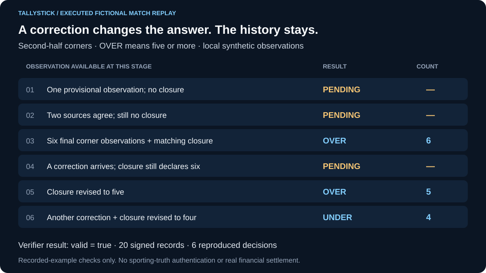
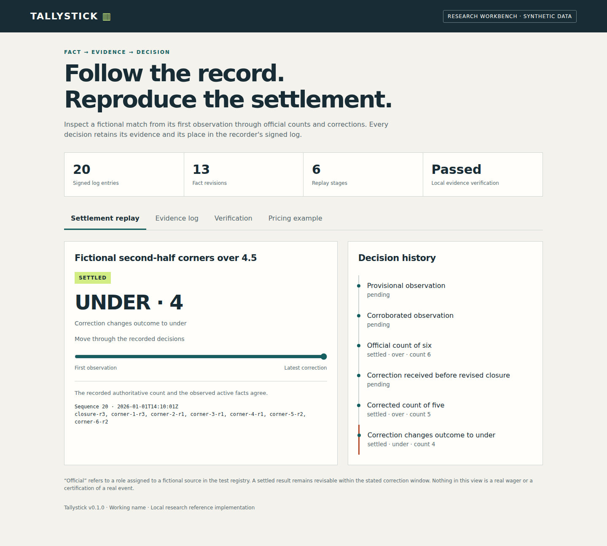

# Tallystick

**A research workbench for sports fact provenance, settlement replay and market-rule checks.**

Version 0.1.0 implements a complete fictional match replay. It records observations,
checks declared data permissions, compiles a small market definition, preserves
corrections and exports evidence that a separate verifier can check. A second,
independent JavaScript evaluator checks the Python settlement implementation.

Tallystick is a working name. This repository is a public experimental reference.
Existing products already use the name; no trade mark clearance is claimed.

The repository became public on 26 October 2026. Independent user reproduction,
the next versioned release and any customer pilot remain separate milestones.

## See it in action

Replay the supplied fictional match observations against a rule requiring at
least five second-half corners. A correction reopens the result until the closure
count agrees; a later correction changes the recorded outcome from over to under.



The illustration follows an executed six-stage replay. Its verifier accepted
20 signed records and reproduced six decisions. This checks a synthetic recorder
history; it authenticates no real sporting fact and performs no financial settlement.

After installing the dependencies in [Run it](#run-it), use a fresh output directory:

```sh
PYTHONPATH=src python -m tallystick demo --output run/readme-demo
```

[Recorded results, verification command and limits](docs/demo/README.md) ·
[Generated offline viewer](docs/demo/index.html) (open it from the checkout;
GitHub displays its source).

<details>
<summary>Earlier dashboard preview</summary>



</details>

[Validation run](https://github.com/Albertito-AI/tallystick/actions/runs/40320423727):
all five jobs passed for implementation commit `28fb41c`, including Windows,
Python 3.11/3.14, optional pricing coherence and both bounded models.

## Run it

Python 3.11 or later is required. Node.js 22 or later is also needed for the
independent conformance tests. The runtime dependency is `cryptography`.

```sh
git clone https://github.com/Albertito-AI/tallystick.git
cd tallystick
python -m venv .venv
# macOS / Linux
. .venv/bin/activate
# Windows PowerShell alternative: .venv\Scripts\Activate.ps1
python -m pip install -e .
python -m tallystick demo --output run/demo
python -m tallystick verify run/demo/dispute.json --public-key-file run/demo/public-key.txt
python -m tallystick serve --directory run/demo --port 8765
```

Open <http://127.0.0.1:8765> on the same machine. The review dashboard contains
a stage slider, fact-revision table, recorder key, verification result and
recomputed mathematical example. It binds to loopback and exposes fixed read-only
routes. It is a local review tool, with no hosted service or public deployment.

Choose a fresh output directory for every run. Existing results are never
overwritten. `run/demo` contains a SQLite ledger, a signed `dispute.json`, a public
key, a summary, the input scenario and a standalone HTML report. A fresh recorder
key is generated for each demo; its private material is not exported.

For an isolated GitHub Codespaces or VS Code development environment, use the
included `.devcontainer` configuration. It prepares Python 3.12, Node.js 22 and
a virtual environment. Run the two commands printed after setup, then open the
forwarded port 8765. This configuration has not been container-built locally;
it does not create a Codespace or provision a hosted service by itself.

## What the replay demonstrates

| Stage | Result | Reason |
| --- | --- | --- |
| One provisional observation | Pending | The reporting period has no completeness declaration |
| Two configured independent sources agree | Pending | Corroboration alone cannot settle the market |
| Six official corner observations and a closure count of six | Over | The count meets the threshold of five |
| One observation is corrected, while the closure still says six | Pending | The active observations and closure disagree |
| The closure is revised to five | Over | The corrected count still meets the threshold |
| Another correction and a revised closure reduce the count to four | Under | The outcome changes and the entire earlier history remains available |

All event names, sources, licences and policy reviewers in the example are
fictional. “Official” is a configured test-source role. No actual league,
supplier or regulator has authenticated the example.

## Implemented components

| Component | Implemented behaviour | Boundary |
| --- | --- | --- |
| Fact ledger | SQLite transactions, exact retry handling, immutable observation revisions, source roles and correction deadlines | A database owner with key access can rewrite storage; externally pinned checkpoints matter |
| Cryptographic evidence | Ed25519 recorder signatures, domain-separated Merkle roots and inclusion proofs, complete-log verification | Authenticates the recorder and representation; does not establish sporting truth or trusted time |
| Market compiler | A small typed count language, complementary outcomes, required source coverage, declared rights and dated TEST policies | Certificates authorise synthetic replay only; pricing coherence is separately assessed |
| Settlement | Official/final state requirements, completeness counts, pending results, abandonment and corrections | Supported event types are corners and goals, with a restricted period-count rule |
| Rights checks | Use, territory, source, fact type and validity-period checks | Fixtures describe permissions; they are not authenticated legal licences |
| Pricing research | Correlated binary events, feasibility bounds, stable LMSR calculations, simulation error, optional finite-outcome coherence LP | Model inputs are assumed; no live forecast or pricing service |
| Batch simulator | Source watermarks, uniform batch quotes, exact retries, mandate and aggregate exposure limits, late-event halt | In-memory synthetic units only; no wagers, payments or order-routing connection |
| Agent interface | A bounded read-only MCP stdio server | Exact supported protocol and tools are documented in `docs/agent-interface.md` |
| Independent checks | JavaScript evaluator, a synthetic 380-match season, adversarial cases and bounded TLA+ models | Conformance and bounded models do not prove production fitness |

## Other commands

```sh
# Read and modify an entirely synthetic example.
python -m tallystick example-scenario > my-scenario.json
python -m tallystick replay my-scenario.json --output run/my-replay

# Compile a market against the example configuration.
python -m tallystick compile examples/market.json --config examples/configuration.json --as-of 2026-01-01T12:00:00Z

# Recompute the paper's numerical example.
python -m tallystick price-example

# Exercise source-watermark gating, common quotes and a late-input halt.
python -m tallystick batch-example

# Run read-only agent tools over stdio.
python -m tallystick mcp

# All unit, integration and independent conformance checks.
python -m unittest discover -s tests -v

# Optional general finite-outcome coherence solver.
python -m pip install -e '.[coherence]'
```

The optional coherence checker returns `UNKNOWN` when an exhaustive outcome
space is not asserted or the solver is unavailable. Pairwise bounds never become
a claim of global coherence.

## Verification and trust

Obtain the recorder's public key through a separate trusted channel. The supplied
demo key file establishes continuity within that fictional run only. A bundle
cannot authenticate its author simply by including a matching key.

Verification checks the manifest, market certificate, complete signed record,
Merkle proofs, source configuration and every recorded settlement decision. Each
decision is reproduced from the facts available at that point. The recorder's
clock and source declarations remain assumptions. There is no external witness,
timestamp authority, provider-signature integration or CT network deployment.

The policy engine has only the fictional `TEST` jurisdiction. Unknown, expired,
unsupported and live jurisdictions fail closed. Consumer flows, single-actor
markets and short-duration markets fail the supplied policy. An aggregate
statistic still needs contextual integrity review; the compiler does not label it
intrinsically safe.

## Project layout

```text
src/tallystick/     Executable Python reference implementation
spec/              Versioned JSON Schemas and format documentation
examples/          Synthetic market, permissions and correction scenario
tests/             Unit and integration checks
conformance/       Independent JavaScript settlement and synthetic season
tla/               Bounded state models and reproducible checking instructions
docs/              Architecture decisions, limits, validation and next phases
.github/           CI, maintenance metadata and contribution templates
```

The whitepaper proposes Rust services and TypeScript interfaces for later
production development. This first reference implementation uses Python and an
independent JavaScript evaluator so that the semantics can be exercised and
compared now. No untested Rust service is represented as complete.

## Foundation and delivery status

The supplied foundation is *The price of a settled fact*, draft 26 October 2026,
uploaded as `Tallystick_Agent_Sports_Data_Report.docx`. Its file hash and the
implementation mapping are in [the foundation record](docs/foundation.md).
The original document is retained separately; it has not been silently edited
or republished as verified current legal or market research.

Read [the foundation review](docs/foundation-review.md),
[settlement semantics](docs/settlement-semantics.md),
[pricing assumptions](docs/pricing.md),
[batch simulator](docs/batch-simulator.md),
[validation record](docs/validation.md) and [roadmap](docs/roadmap.md).

The next delivery phase is an authorised shadow replay against a permitted
external dataset, with explicit completeness criteria and an independent
comparison. Live-feed contracts, supplier licensing, reviewed real-jurisdiction
policies, production infrastructure, security assessment, liability arrangements
and operator acceptance remain prerequisites for any live service.

## Build with us

We welcome co-creators in engineering, documentation, testing and domain review.
Start with the [contribution guide](CONTRIBUTING.md), which contains three bounded
starter tasks and their completion evidence. Reproducing the quickstart, checking
correction edge cases and explaining evidence verification are useful first steps.
Use [Issues](https://github.com/Albertito-AI/tallystick/issues) to coordinate a task
and pull requests to propose changes. Keep all public examples synthetic or
documented as permitted for publication.

Accepted contributions receive accurate credit. When funded opportunities arise,
we can agree paid development, research, documentation or support work. Roles,
deliverables, intellectual-property arrangements and payment terms must be agreed
before that work begins. Participation alone creates no payment entitlement or
automatic revenue share.

## Licensing

Original executable code and documentation are under Apache-2.0; see [LICENSE](LICENSE)
and [NOTICE](NOTICE). Original schemas and format definitions under `spec/` are
under CC BY 4.0 as proposed in the foundation; see [spec/LICENSE](spec/LICENSE).
Third-party dependencies keep their own licences. No rights to sports feeds,
league data, names, marks or the supplied whitepaper are granted by these files.

Copyright 2026 Albert Tan Sin Hon.
